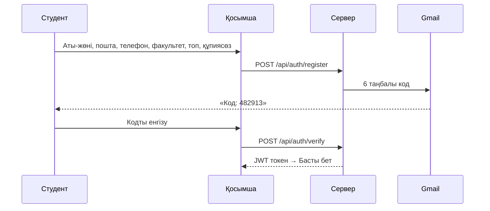

# Campus Hub · ALT University

ALT University студенттеріне арналған жеке мобильді қосымша (Expo / React Native).

## Іске қосу

```bash
npm install
npx expo start -c
```

Телефондағы **Expo Go** қосымшасымен QR-кодты сканерлеңіз.
Басқа желіден қосылу үшін: `npx expo start --tunnel`. Браузерде ашу үшін: `npx expo start --web`.
Тіркелу мен кіру үшін серверді де іске қосыңыз: `npm run server` (төменде).

Тексеру: `npx tsc --noEmit`

## Бөлімдер

Platonus пен alt.edu.kz үлгісімен: **Басты** (келесі сабақ, бүгінгі кесте, жаңалықтар), **Журнал** (РК1, РК2, емтихан,
жіберілу рейтингі, қорытынды баға, әріптік баға және GPA, қатысу, апталық бағалар), **Кесте** (апта күндері бойынша),
**Жаңалықтар** (alt.edu.kz), **Профиль** (студент деректері, транскрипт, баптаулар). Кампус сервистері Басты беттен ашылады.
Бағалау: рейтинг = (РК1 + РК2) / 2, қорытынды = рейтинг × 0,6 + емтихан × 0,4 (`src/utils/grades.ts`).
Бағалар, кесте және транскрипт — демо деректер (`src/data/academic.ts`).

## Тіркелу және кіру (өз сервер)

Авторизацияны `server/` бумасындағы Node.js сервері жасайды (Node 22.15+, сыртқы пакеттерсіз): SQLite (`node:sqlite`)
базасы, құпиясөз тек `scrypt` хеші, 6 таңбалы код HMAC хеші түрінде сақталады, кіргеннен кейін JWT токен беріледі.



- Код 10 минут жарамды, 5 әрекет, қайта жіберу 60 секундтан кейін, сағатына ең көбі 6 код.
- Расталмаған аккаунтпен кіруге болмайды: кіру әрекетінде жаңа код жіберіледі.
- Сұраныс жиілігі IP бойынша шектеледі; «барлық құрылғылардан шығу» ескі токендерді жарамсыз етеді.

### Іске қосу

```bash
npm run server          # http://localhost:3000/api
npm run test:server     # API және SMTP тесттері
```

Қосымшаның `.env` файлында сервер мекенжайы: `EXPO_PUBLIC_AUTH_API=http://localhost:3000`
(телефоннан: компьютердің IP мекенжайы, мысалы `http://192.168.1.10:3000`, немесе хостинг URL-і).

**Демо режим:** `server/.env` ішінде пошта бапталмаса, код сервер консолінде және қосымшаның экранында көрсетіледі.

### Поштаға нағыз код (Gmail)

1. Google аккаунтында **2-Step Verification** қосыңыз.
2. https://myaccount.google.com/apppasswords бетінде **App password** жасаңыз (16 таңба).
3. `server/.env.example` файлын `server/.env` деп көшіріп, толтырыңыз:
   ```
   SMTP_HOST=smtp.gmail.com
   SMTP_PORT=465
   SMTP_USER=сіздің@gmail.com
   SMTP_PASS=xxxxxxxxxxxxxxxx
   MAIL_FROM=Campus Hub <сіздің@gmail.com>
   DEV_SHOW_CODES=false
   ```
4. Серверді қайта іске қосыңыз. Консольде `Email: SMTP smtp.gmail.com` жазуы шығуы керек.

SMTP порттарын бұғаттайтын хостингте (мысалы, Render free) хатты `server/deploy/mail-relay.gs`
(Google Apps Script) арқылы жіберіңіз: `MAIL_WEBHOOK_URL` және `MAIL_WEBHOOK_SECRET`.

| Файл | Мақсаты |
|------|---------|
| `server/routes/auth.js` | Тіркелу, кодпен растау, кодты қайта жіберу, кіру, профиль |
| `server/security.js` | scrypt, JWT, кодтар, тексерулер, rate limit |
| `server/notify.js` | Хат жіберу: SMTP (TLS / STARTTLS) немесе Apps Script relay |
| `src/context/AuthContext.tsx` | Қосымша жағы: сервермен жұмыс, токенді сақтау |
| `src/screens/LoginScreen.tsx`, `RegisterScreen.tsx`, `VerifyEmailScreen.tsx` | Кіру, тіркелу, поштаны растау экрандары |

## Дизайн

Apple-дың **Liquid Glass** (iOS 26) стилі ALT брендімен: көк `#005DAC`, қою көк `#091A2C`, қызғылт сары `#FF9900`.
Мөлдір шыны карточкалар mesh-градиент фонның (`assets/backdrop-*.png`) үстінде, таб-бар қалқып тұратын шыны капсула.
Мәтін түстері ашық және қараңғы тақырыпта WCAG AA (≥ 4.5:1) талабынан өтеді, «Қозғалысты азайту» баптауы ескеріледі.

## Тексеру сценарийі (№7)
1. Settings экранын ашып, тақырыпты қараңғыға ауыстыру
2. Home және Profile экрандарындағы түстердің өзгергенін көру
3. Қаріп өлшемін A+ етіп, мәтіннің үлкейгенін көру
4. Қосымшаны толық жауып, қайта ашу: баптаулар сақталып қалады

## №8 зертханалық жұмыс: REST API

**Жаңалықтар** табы ALT Университетінің ресми сайтынан ([alt.edu.kz](https://alt.edu.kz)) соңғы 10 жаңалықты
WordPress REST API арқылы алады: `GET /wp-json/wp/v2/posts?categories=…&per_page=10&_embed=wp:featuredmedia`.
Жаңалықтар қосымшаның тіліне сай келеді (санаттар: қазақша 29, орысша 4, ағылшынша 47).
API мекенжайы `.env` файлындағы `EXPO_PUBLIC_API_URL` айнымалысында.

| Файл | Мақсаты |
|------|---------|
| `src/types/announcement.ts` | API жауабының (`WpPost`) және қосымшадағы жаңалықтың (`Announcement`) TypeScript типтері |
| `src/api/announcements.ts` | GET сұраныстары (`fetch` + AbortController) және AsyncStorage кэші |
| `src/utils/html.ts` | WordPress HTML-ін (Divi шорткодтарын қоса) таза мәтінге айналдыру |
| `src/components/AnnouncementCard.tsx` | Суреті, күні және қысқаша мәтіні бар карточка |
| `src/screens/NewsScreen.tsx` | Тізім: loading, error, empty, FlatList, pull-to-refresh, іздеу |
| `src/screens/NewsDetailsScreen.tsx` | `announcementId` бойынша толық жаңалық және «Сайтта ашу» батырмасы |

Қосымшаның басқа деректері де университетке сай: Сервистер (кітапхана, Help Desk, денсаулық пункті,
студенттер үйі, мансап кеңсесі т.б.) мекенжайлары мен телефондары сайттан алынды, Home бетінде соңғы жаңалықтар көрсетіледі.

Қосымша тапсырмалар: тақырып бойынша іздеу, empty күйі, AbortController (экран жабылғанда немесе жаңа сұраныста алдыңғысы тоқтатылады), AsyncStorage кэші (желі жоқта соңғы деректер көрсетіледі), `.env`.

### Тексеру сценарийі (№8)
1. Жаңалықтар табын ашу: алдымен жүктеу индикаторы, кейін alt.edu.kz сайтының 10 жаңалығы
2. Карточканы басу: NewsDetails экраны толық мәтінмен ашылады
3. Баптаулардан тілді ауыстыру: жаңалықтар сол тілде қайта жүктеледі
4. Іздеу өрісіне сөз жазу: тізім сүзіледі, сәйкестік болмаса empty күйі
5. Интернетті өшіріп, тізімді төмен тарту: кэштен деректер және «Желі жоқ» белгісі
6. Кэш жоқ кезде (бірінші іске қосу) интернетсіз ашу: қате хабарламасы және «Қайталау» батырмасы
7. Интернетті қосып, «Қайталау» немесе төмен тарту: деректер жаңарады
